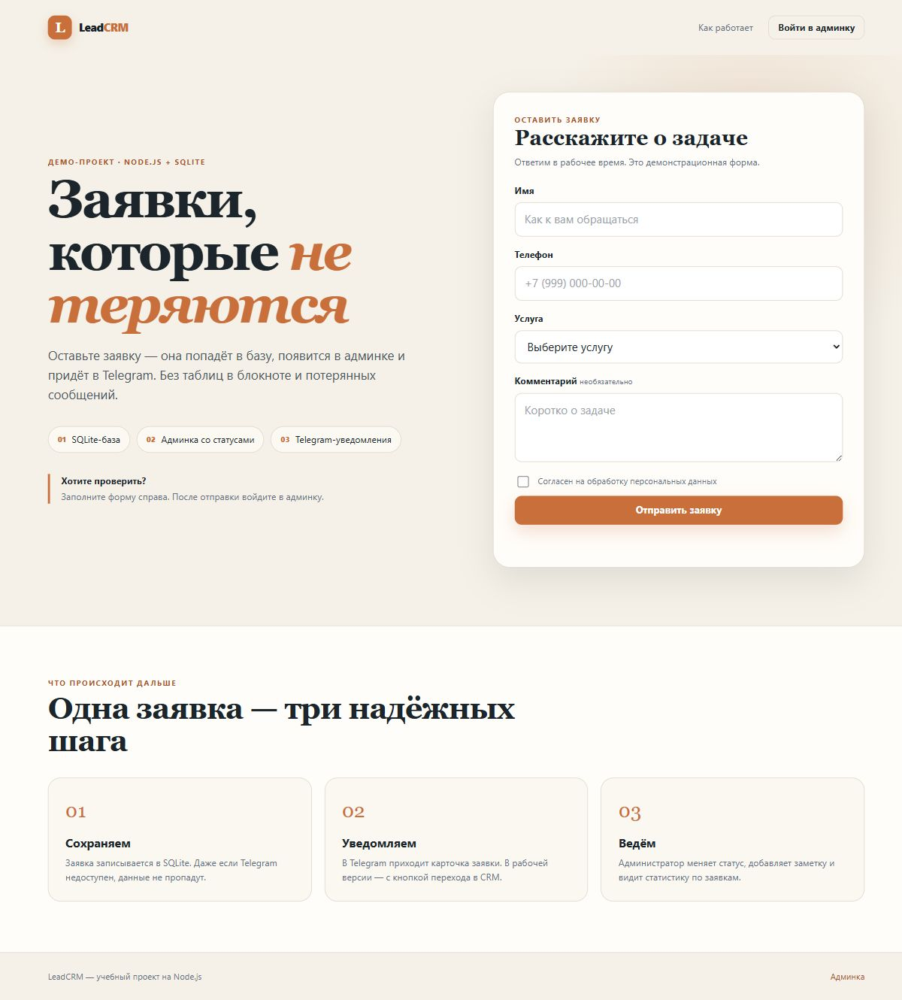
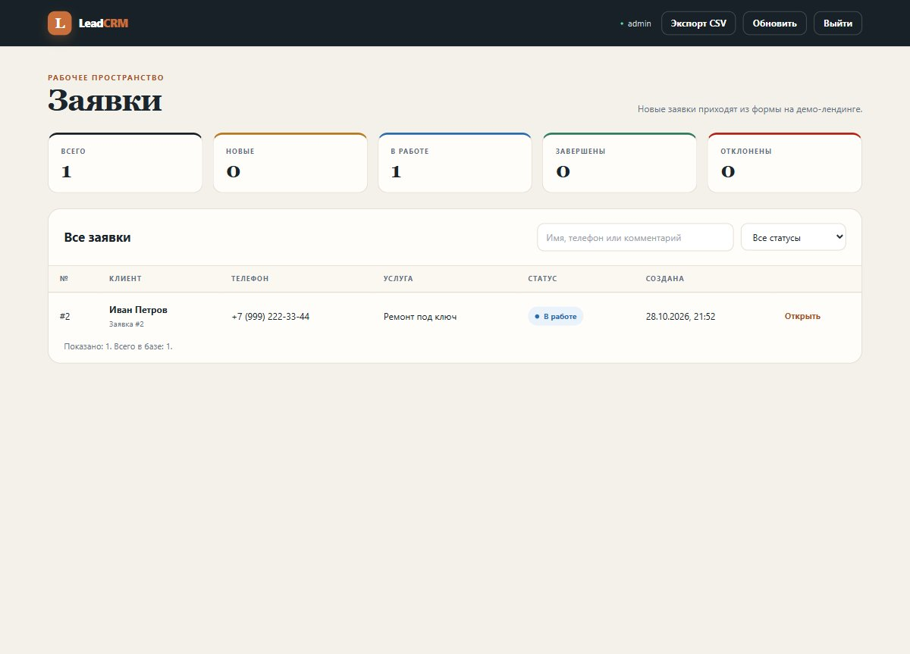

# LeadCRM

CRM заявок на Node.js: демо-лендинг с формой, SQLite-база, админка со статусами,
заметками и экспортом CSV, Telegram-уведомления.

Проект сделан без фреймворков, сборщиков и npm-зависимостей. Для базы используется
встроенный в Node.js модуль `node:sqlite`.

## Что умеет

- Принимает заявки с формы и сохраняет их в SQLite.
- Показывает заявки в админке: поиск, фильтр по статусу, статистика.
- Позволяет менять статус, оставлять заметку и удалять заявку.
- Отправляет новую заявку в Telegram. Если Telegram недоступен, заявка всё равно
  сохраняется, а отправку можно повторить из карточки заявки.
- Экспортирует все заявки в CSV для Excel.
- Защищает админку: пароль хранится как scrypt-хеш, сессии лежат в базе,
  запросы, меняющие данные, требуют CSRF-токен.

## Скриншоты





## Быстрый старт

Требуется Node.js 22.5+ (проверено на Node.js 24).

```powershell
cd D:\projects\leads-crm
npm start
```

Откройте:

- демо-лендинг: `http://127.0.0.1:3000/`
- админка: `http://127.0.0.1:3000/admin`
- проверка сервера: `http://127.0.0.1:3000/api/health`

В текущей локальной папке уже создан `.env` с демо-данными:

```text
Логин:  admin
Пароль: admin12345
```

Пароль задаётся в `.env`. Перед публикацией обязательно смените его на длинный
уникальный.

Если вы клонировали репозиторий заново и `.env` ещё нет:

```powershell
Copy-Item .env.example .env
```

После этого задайте `ADMIN_PASSWORD` и остальные значения.

## Настройка

Основные переменные:

| Переменная | Назначение |
| --- | --- |
| `HOST` | Адрес сервера. Локально `127.0.0.1`, на хостинге обычно `0.0.0.0` |
| `PORT` | Порт, по умолчанию `3000` |
| `ADMIN_LOGIN` | Логин администратора |
| `ADMIN_PASSWORD` | Пароль администратора |
| `DB_PATH` | Путь к SQLite-файлу, по умолчанию `./data/crm.sqlite` |
| `BOT_TOKEN` | Токен Telegram-бота |
| `CHAT_ID` | ID чата, куда отправлять заявки |
| `PUBLIC_BASE_URL` | Публичный адрес CRM для кнопки в Telegram |
| `CORS_ORIGIN` | Домен(ы) формы, если она на другом сайте; можно через запятую |

После изменения `ADMIN_PASSWORD` перезапустите сервер: при старте пароль
пересчитывается из `.env`.

## Telegram

1. Создайте бота через `@BotFather` и получите токен.
2. Напишите боту любое сообщение.
3. Узнайте `chat_id` (например, через `getUpdates`).
4. Заполните `BOT_TOKEN` и `CHAT_ID` в `.env`.
5. Перезапустите сервер.

Если `PUBLIC_BASE_URL` указывает на публичный HTTPS-адрес, в уведомлении появится
кнопка «Открыть в CRM». Для `localhost` кнопка не добавляется.

## Как подключить существующий лендинг

CRM принимает заявки на `POST /api/leads` в формате:

```json
{
  "name": "Иван",
  "phone": "+7 (999) 000-00-00",
  "service": "cosmetic",
  "message": "Нужен ремонт кухни",
  "consent": true
}
```

Допустимые услуги: `cosmetic`, `capital`, `turnkey`, `other`.

Если форма открыта с другого домена:

1. Укажите этот домен в `CORS_ORIGIN`, например
   `CORS_ORIGIN=https://v1reless.github.io`.
2. В HTML лендинга подставьте endpoint CRM. В текущем `repair-landing` это
   делается через meta-тег `form-endpoint`:

```html
<meta name="form-endpoint" content="https://your-crm.example.com/api/leads">
```

3. Перезапустите CRM и проверьте отправку с лендинга.

## API

| Метод | Путь | Доступ | Назначение |
| --- | --- | --- | --- |
| `GET` | `/api/health` | публично | Проверка сервера и Telegram |
| `POST` | `/api/leads` | публично | Создать заявку |
| `POST` | `/api/login` | публично | Войти в админку |
| `GET` | `/api/me` | админ | Текущий пользователь и CSRF-токен |
| `POST` | `/api/logout` | админ | Выйти |
| `GET` | `/api/leads` | админ | Список заявок, фильтры `status`, `q` |
| `GET` | `/api/leads/:id` | админ | Одна заявка |
| `PATCH` | `/api/leads/:id` | админ | Статус и заметка |
| `POST` | `/api/leads/:id/telegram` | админ | Повторить Telegram-уведомление |
| `DELETE` | `/api/leads/:id` | админ | Удалить заявку |
| `GET` | `/api/export.csv` | админ | Экспорт в CSV |

Запросы, меняющие данные (`PATCH`, `DELETE`, `POST /api/logout`), требуют заголовок
`X-CSRF-Token`. Токен возвращает `/api/me` после входа. Cookie сессии —
`HttpOnly` и `SameSite=Lax`.

## База данных

Файл базы: `data/crm.sqlite`. Папка `data/` и `.env` не попадают в Git.

Сбросить демо-базу:

```powershell
# Сначала остановите сервер
Remove-Item data\crm.sqlite*
npm start
```

После перезапуска база создастся заново, а администратор — из `.env`.

## Структура проекта

```text
leads-crm/
  server.js          HTTP-сервер, API, статика, сессии
  db.js              SQLite-схема
  auth.js            пароли, сессии, CSRF
  telegram.js        уведомления
  load-env.js        чтение .env
  public/
    index.html       демо-лендинг
    login.html       вход
    admin.html       админка
    styles.css       общий дизайн
    landing.js       форма
    login.js         вход
    admin.js         список, фильтры, диалог заявки
  data/              SQLite (создаётся автоматически, не коммитится)
```

## Публикация

GitHub Pages не подходит: там нет Node.js и постоянной базы. Нужен хостинг,
который умеет запускать Node.js, например Render, Railway или VPS.

Для Render:

- Build command: оставить пустым или `npm install` (зависимостей нет).
- Start command: `npm start`.
- Environment: перенести переменные из `.env`.
- `HOST=0.0.0.0`.
- `NODE_ENV=production`.
- `COOKIE_SECURE=1`.
- `PUBLIC_BASE_URL=https://ваш-адрес`.
- Для SQLite нужен постоянный диск. Без него база может исчезнуть при
  перезапуске/пересборке контейнера.

## Безопасность

- Не коммитьте `.env`: там пароль и токен бота.
- Смените демо-пароль `admin12345` до публикации.
- Используйте HTTPS и `COOKIE_SECURE=1` в production.
- Делайте резервные копии `data/crm.sqlite`.
- Не публикуйте админку без необходимости; при публикации добавьте ограничение
  доступа по IP или отдельный слой авторизации.
